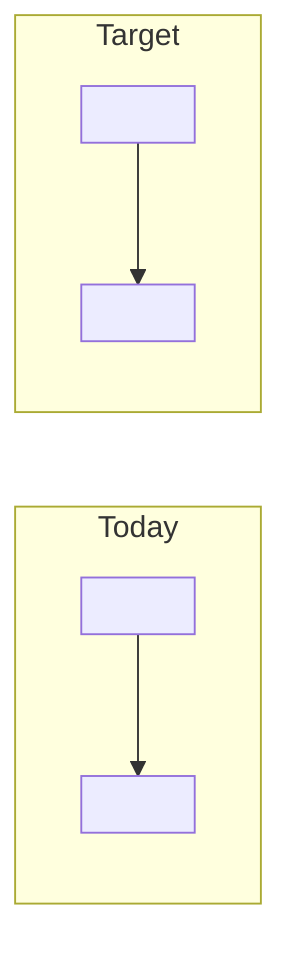

# Requirement analysis

From the business request (`docs/00_context/request.md`) to stories. Answers to open questions given by
<name> on <YYYY-MM-DD>.

## Process today vs. target

## Actors and what each needs

| Actor | Needs | Story |
| :--- | :--- | :--- |
| <actor> | <need> | HU-NNN |

## Epics and story map

| Epic | Must | Should | Could |
| :--- | :--- | :--- | :--- |
| E1 <epic> | HU-NNN <story> | | |

**MVP slice:** <which stories go first and why>.

## Non-functional requirements

| Topic | Requirement | Source |
| :--- | :--- | :--- |
| Volume | <requests/users/peaks> | Request / Q# |
| Availability | <target> | |
| Privacy / security | <personal data, retention, encryption> | |
| Language / accessibility | <languages, WCAG level> | |

## Open questions

| # | Question | Answer |
| :--- | :--- | :--- |
| Q1 | <question> | <answer, or "pending — owner"> |

## Out of scope

<what was explicitly left out, beyond the vision's list>
